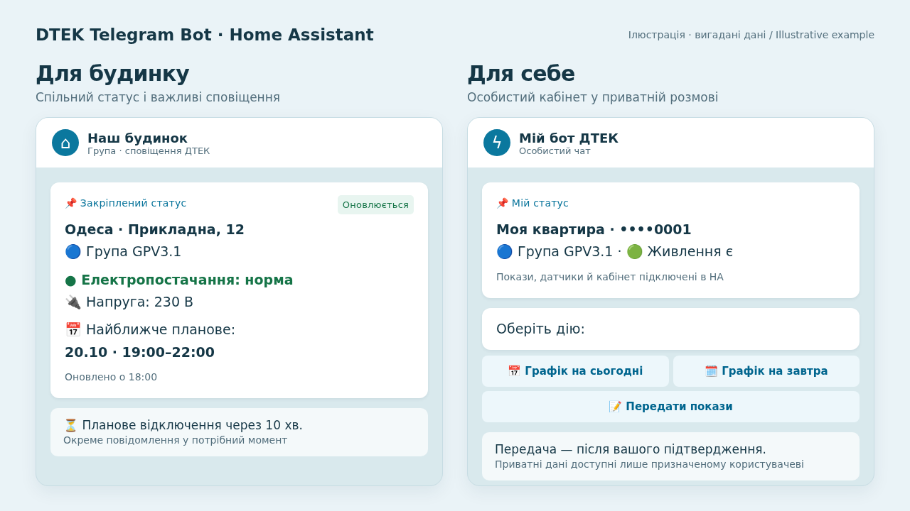

# DTEK Telegram Bot for Home Assistant

**English** · [Українська](README.uk.md)

[](https://my.home-assistant.io/redirect/supervisor_add_addon_repository/?repository_url=https%3A%2F%2Fgithub.com%2Fgroove-max%2Fha-dtek-telegram-bot)

[](https://github.com/groove-max/ha-dtek-telegram-bot/releases/latest)
[](https://github.com/groove-max/ha-dtek-telegram-bot/actions/workflows/tests.yml)
[](LICENSE)

**DTEK outage alerts, a current power status and personal meter readings — in Telegram.** Notify your building group or channel, or use a private conversation for your own account. One Home Assistant app supports both modes, several addresses and several bot tokens.

Works with [DTEK Monitor](https://groove-max.github.io/ha-dtek-monitor/en/) for **Odesa oblast, Kyiv city, Kyiv oblast and Dnipropetrovsk oblast**. Local power sensors are optional. Cabinet features for Kyiv oblast and Dnipropetrovsk oblast are experimental.

**[Install](#installation)** · [Documentation](https://groove-max.github.io/ha-dtek-telegram-bot/en/) · [Latest release](https://github.com/groove-max/ha-dtek-telegram-bot/releases/latest) · [DTEK Monitor integration](https://github.com/groove-max/ha-dtek-monitor)



## Choose how you want to use the bot

| I want | Start here |
| --- | --- |
| Schedule and power alerts for a building, group or channel | [Building mode](docs/BUILDING.md); no DTEK cabinet login needed. |
| Only address alerts, sent privately to me | The same [building mode](docs/BUILDING.md), with a private recipient. |
| My apartment's cabinet group, reading history and meter submission | [Personal mode](docs/PERSONAL.md); connect the cabinet in DTEK Monitor and authorize your private Telegram user. |
| Actual power and voltage alerts | Add suitable [HA sensors](docs/POWER.md) to either mode. |

You create your own bot with BotFather and control its recipients in Home Assistant. Writing to someone else's bot does not subscribe you to an address or grant access to an account. The web editor and default Telegram messages use Ukrainian; English and Ukrainian setup guides are available.

<a id="features"></a>
## What it does

- Announces changes to outage schedules and address groups.
- Warns before a planned outage; you choose how many minutes ahead.
- Handles outages across midnight without duplicate warnings and marks unverified end times as unknown when the integration supplies publication coverage.
- Relays DTEK's outage reasons and estimated restoration times.
- Detects power loss/restoration from suitable local sensors, with delays to filter short dips.
- Supports one phase or multiple voltage sensors, including partial outages.
- Optionally alerts on low/high voltage and recovery.
- Updates a pinned status instead of filling the chat with status posts.
- Shows today’s or tomorrow’s all-group schedule as a PNG from the personal menu.
- Shows DTEK reading history, sends optional reminders and submits your cumulative readings after explicit confirmation in private mode.
- Uses compatible energy-sensor suggestions and calibration from My DTEK; a sensor is not required for manual entry.
- Provides a web editor for addresses, notifications, templates, previews and diagnostics.

Example pinned message — illustrative address, readings and schedule:

```text
🟢 Odesa • Example building
🔵 Група GPV3.1
✅ Електропостачання: норма
🔌 🟢 L1: 230.0 В
📅 Найближче планове:
17.10 — 19:00–22:00
🕒 Оновлено: 17.10.2026 18:00
```

The built-in web editor and Telegram messages currently use Ukrainian. English documentation does not change the message language; edit the [message templates](DOCS.md#templates) to use your own wording.

<a id="requirements"></a>
## Which project do I install?

| Project | Purpose | Installation |
| --- | --- | --- |
| [DTEK Monitor](https://github.com/groove-max/ha-dtek-monitor) | Fetches DTEK data and creates HA sensors/calendars | HACS custom integration or manual copy |
| **DTEK Telegram Bot** — this repository | Sends Telegram messages using those entities and optional local sensors | Home Assistant app repository, not HACS |

Use **Home Assistant OS**, Home Assistant **2026.3.0+**, and an `amd64` or `aarch64` device. You also need a DTEK Monitor building or connected cabinet and your own Telegram bot token. Select your recipient from detected users/chats after `/start`, or enter the numeric ID manually.

**Bot 0.5.0-rc4** keeps building alerts compatible with Monitor 1.7.0 and 2.0.0b1. Use **bot 0.5.0-rc4 or newer** and **Monitor 2.0.0-rc4 or newer** for personal cabinets and PNG schedule tables. The projects have independent version numbers. [Compatibility and setup →](DOCS.md#dtek-monitor)

**Two modes in one installation.** Address schedules send alerts to a private chat, group or channel without a cabinet login. Personal cabinet mode adds apartment groups, reading history, reminders and confirmed submissions, only for an assigned private user. Both modes support local power sensors. [Personal mode guide](docs/PERSONAL.md). Attach optional meter photos during reading review and open cabinet documents from the same private menu. Document retrieval is experimental; [photo and document instructions](docs/PERSONAL.md#meter-photos-and-dtek-documents).

**Several addresses, chats or bots? Use one installation.** Each address has its own notifications, sensors, group selection and Telegram bot profile. Keep the default bot or add another token once in **Telegram bots** and reuse that profile for several addresses. See [addresses, chats and bots](DOCS.md#destinations).

Home Assistant now calls add-ons **apps**; older installations show **Add-ons** instead. HA Container does not include the app manager. See [Home Assistant's app requirements](https://www.home-assistant.io/apps).

<a id="installation"></a>
## Install

1. Install [DTEK Monitor](https://github.com/groove-max/ha-dtek-monitor#installation). Add an address for building schedules, or connect your cabinet for personal mode.
2. Create a bot with [@BotFather](https://t.me/BotFather), using `/newbot`. Keep its token.
3. Open **Settings → Apps → Install app → ⋮ → Repositories**. Older versions call this **Add-ons → Add-on Store**.
4. Add `https://github.com/groove-max/ha-dtek-telegram-bot` and install **DTEK Telegram Bot**. Use the current version shown by the app store; [latest release notes](https://github.com/groove-max/ha-dtek-telegram-bot/releases/latest).
5. In **Configuration**, enter `telegram_bot_token`. You can leave `telegram_chat_id` empty for now and choose a recipient in the editor. Start the app and choose **Open web UI**.
6. Open your bot in Telegram and send `/start`. For a group, add the bot and send `/start@your_bot_username`; for a channel, make it an administrator with posting/editing rights. Group/channel pinning needs the corresponding permission.
7. Follow the wizard below. On the **Telegram** step, press **Оновити (Refresh)** to select yourself or a chat. [If the list is empty](DOCS.md#telegram).

You do not normally need to create a Home Assistant access token: the app uses Supervisor access automatically.

<a id="setup"></a>
## Configure your first profile

For personal use, a conversation with the bot is enough: no group or channel is needed. Before enabling a shared feed, test in your private chat or a small test group.

1. In **Налаштування**, choose **Додати профіль** (Add profile). The wizard starts with **Графіки за адресою** (address schedules) or **Особистий кабінет** (personal cabinet). Address schedules can also be sent privately; they do not require a shared chat.
2. Select your building or connected cabinet account and give the profile a recognizable name. Leave the building's group empty to follow every address group. Personal profiles use the cabinet's groups.
3. Choose a bot and recipient. Select a discovered chat/user or enter its ID. A personal cabinet requires an explicitly selected private owner; discovery never grants access automatically.
4. Enable the notifications you need. Power sensors are optional; choose them using the guide below. Voltage display/quality alerts are separate from power detection.
5. Review the destination and notifications, then press **Застосувати** (Apply). This validates, saves and restarts the app. Notifications start after the restart.
6. Check **Поточний стан** (Current status). Optional template previews and test sends are under **Інструменти → Шаблони**. A test sends a real labeled message to the configured test destination.

Each profile has its own card; **Налаштувати** opens one editor at a time. Drafts survive refreshes and navigation. Import/export, standalone validation and saving without restart are under **Додаткові дії**. Technical metrics and fallback HA credentials are no longer part of the first setup.

**Success looks like:** HA is connected, your address and group are recognized, the test appears in the intended chat, and the status message can be edited. Local power may correctly show `unknown` when no fresh measurement is available.

For enforced test routing, set the app option `test_chat_id` to your private chat, test group or channel before starting. For building profiles, it overrides the destination. Personal profiles and their template tests accept only the authorized private user as a test destination. See [isolated testing](DOCS.md#testing).

<a id="power-detection"></a>
## Choose how to detect power

| Available equipment | Choose | What it can establish |
| --- | --- | --- |
| No local sensor | DTEK only | DTEK's reported state; not a physical measurement. |
| A ready HA binary status | HA sensors → that binary sensor | Explicit presence/absence; choose whether `on` or `off` means grid present. |
| One backed-up voltage or frequency sensor | HA sensors → that measurement | Fresh numeric readings establish presence/absence. |
| Two independent voltage/frequency/status sources on the same feed | HA sensors + optional confirmation | Matching evidence establishes power; disagreement means unknown. |
| Backed-up input sensor + meter that powers off with the grid | HA sensors + “switches off with the grid” confirmation | An explicit primary loss plus the previously observed secondary going silent can confirm loss after the grace period. |

The primary sensor, its connection and HA must keep working during an outage. Measure the **grid input**, not a backed-up inverter output. A lone mains-powered sensor disappearing cannot prove an outage.

Select voltage display and quality warnings separately. For example, an authoritative binary status can drive outage notifications while a different voltage meter supplies the displayed voltage. Two redundant sensors on one line are not two phases. Existing `voltage_only` / `loss_plus_voltage` configurations and their multiphase behavior remain supported without automatic conversion.

[Sensor setup, examples, freshness and transition rules →](docs/POWER.md)

Standalone telemetry-loss/recovery notices are **off by default** (`power.telemetry_notifications: false`). The pinned status still reflects missing data. Confirmed outage and recovery messages remain available.

<a id="schedules"></a>
## Schedules, groups and status

- A schedule is a plan, not a measurement. DTEK emergency restrictions can override it.
- Multiple address groups are kept separate. Selecting one does not prove that it is your apartment's group.
- Operators that hide public group numbers are shown as **«Варіант 1», «Варіант 2»**. These are local labels, not official queue numbers.
- Failed or inconsistent schedule checks pause schedule-related notifications. Saved display-only calendars cannot trigger alerts.
- An unpublished date is not announced as “no outages.”
- The default status mode edits one message. `send_new` is available if you intentionally want new status posts.

<a id="troubleshooting"></a>
## Troubleshooting

| Symptom | What to do |
| --- | --- |
| Cannot find the app | Add this repository to the HA app store, not HACS. Check the installation method and CPU architecture. |
| Address is missing from discovery | Check the building's entities and HA connection. With Monitor 2.0, verify the account's building link; the account itself is not a bot address. [Connection guide](DOCS.md#dtek-monitor). |
| Monitor 1.7.0 says “Current schedule coverage is missing” during setup | This known integration issue can prevent entity creation. Monitor 2.0.0b1 fixes it; see [upgrade and rollback](DOCS.md#monitor-upgrade). |
| Recipient list is empty | Check **Receive commands**, send a new `/start` after startup, then refresh. Only new Telegram updates are discoverable. [Recipient guide](docs/PERSONAL.md#detected-telegram-recipients). |
| Personal menu or history is unavailable | Check the [compatible versions](docs/UPGRADING.md), select your account and private user, Apply, then send `/start`. Check that the cabinet is connected in HA. |
| No Telegram messages | Verify token, full chat ID and bot permissions; try a labeled template test and inspect the app log. |
| Settings appear saved but behavior is unchanged | Use **Apply (Застосувати)** and check the pending-restart indicator. |
| Power is `unknown` | Inspect the sensor's availability, reporting time and configured maximum age. A stale number does not prove power. |
| Status posts keep appearing | Check `delivery_mode`; use `pinned_edit` and ensure the bot can edit its own message. |
| Group is listed twice in a custom message | Reset that template to the current default, or update the override. Overrides survive app upgrades. |
| Schedule notices stopped | Check DTEK Monitor's connection and, in 2.0, **Schedule availability**. Missing publication is not a confirmed empty schedule. [Availability states](DOCS.md#schedule-availability). Local sensor monitoring can continue. |

<a id="support"></a>
## Guides and support

- [Building setup](docs/BUILDING.md) · [Personal cabinet](docs/PERSONAL.md) · [Power sensors](docs/POWER.md).
- [Full user guide](DOCS.md): Telegram setup, configuration examples, sensor requirements, templates, backups and test routing.
- [Report an issue](https://github.com/groove-max/ha-dtek-telegram-bot/issues): include versions, mode and sanitized diagnostics. English and Ukrainian are welcome.
- [DTEK Monitor](https://github.com/groove-max/ha-dtek-monitor): report missing addresses or incorrect upstream entities there.
- [Changelog](CHANGELOG.md) · [Latest release](https://github.com/groove-max/ha-dtek-telegram-bot/releases/latest).
- [Contributing](CONTRIBUTING.md) · [Security](SECURITY.md).

This is an independent community project, not an official DTEK or Telegram product. Licensed under [PolyForm Noncommercial 1.0.0](LICENSE). Noncommercial use, modification and redistribution are permitted under its terms; commercial use is not granted. This is source-available software, not an OSI open-source license. Earlier MIT releases retain their original terms. Dependencies keep their own licenses. See [NOTICE](NOTICE).
